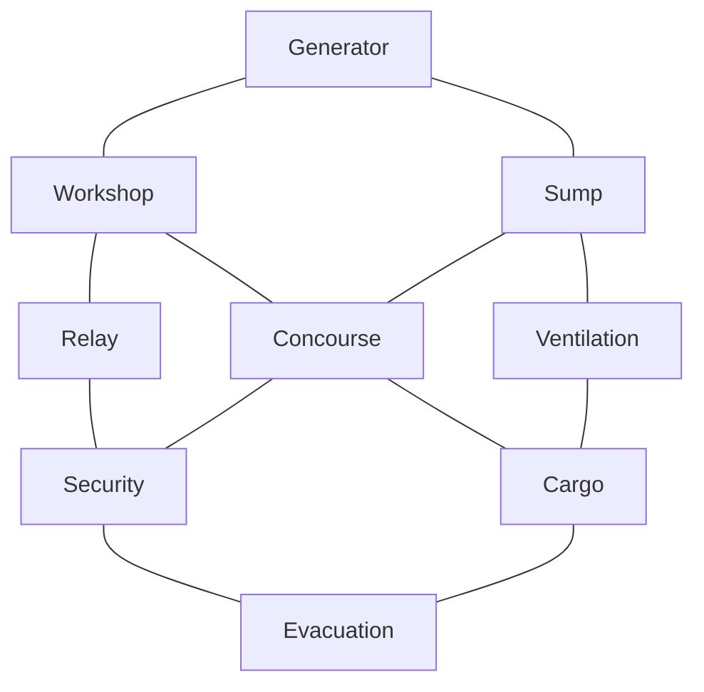

# Relay Station 17

The world is 960 × 720 units. Nine rooms form a 3 × 3 connected lattice; each horizontally or vertically adjacent pair has one open passage. Multiple loops provide alternate routes. Walls constrain movement, while machinery is decorative.

| Position | West | Center | East |
|---|---|---|---|
| North | Generator / Power | Workshop / Filters | Relay Control / Relay |
| Middle | Sump / Purge Pumps | Concourse / Alarm / Spawn | Security / Repeater |
| South | Ventilation / Air | Cargo / Lift Control | Evacuation / Lift zone |

Room origins are x=32/348/664 and y=32/272/512, each 264 × 176. Horizontal passages are 68 × 40 and vertical passages 40 × 80. The full public schematic has no player positions. Generator and Evacuation contain hostile-only maintenance hatches. The marked Generator floor patch is the electrical hazard. Air Failure affects Sump, Ventilation and Cargo, with exits remaining usable.

Approximate center-to-center traversal: 3 seconds horizontally and 2.3 seconds vertically. Crossing the map takes about 11 seconds along a clear route. These are geometric estimates, not measured human movement times.
