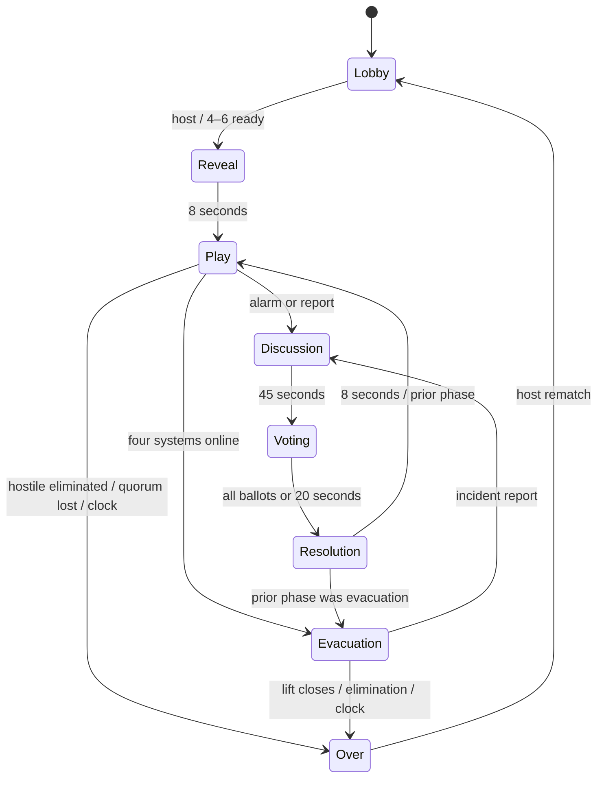

# Match state machine

Permanent disconnect can terminate any started phase as SHIFT VOID. Training transitions directly from Lobby to Play. World clocks pause in briefing and meetings; reconnect grace uses wall-clock time. The single event loop serializes commands. Results are immutable until the host opens a new lobby. Rematch clears hazards, bodies, progress, work orders, alarms, timers and the one-time natural fault.
